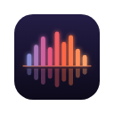
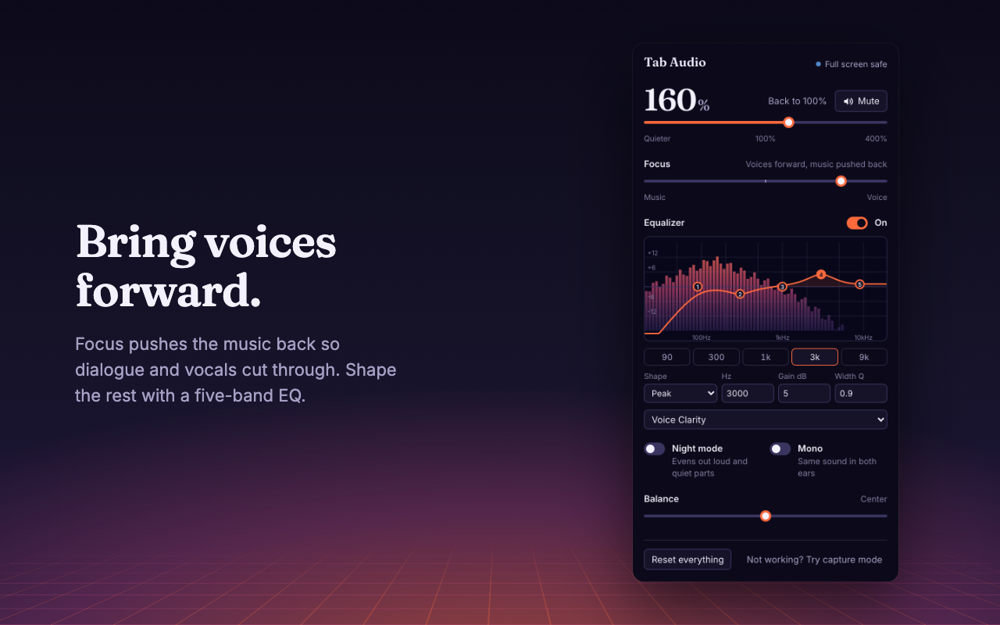

<p align="center">
  
</p>

<h1 align="center">Tab Audio Control</h1>

<p align="center">
  Per-tab volume, boost, EQ and voice focus for Chrome that doesn't break full screen.
</p>

<p align="center">
  <a href="https://github.com/jstilwell/tab-audio-control/actions/workflows/ci.yml"></a>
  <a href="LICENSE"></a>
  
  
</p>

<p align="center">
  
</p>

## Features

- **Volume from 0 to 400%.** Make a tab quieter, mute it, or boost it, with a limiter so boosts don't distort.
- **Full screen keeps working.** Videos still fill your monitor (see [how](#how-full-screen-keeps-working)).
- **Voice focus.** Push the music back so dialogue and vocals come through, or the opposite for a rough karaoke mode.
- **Five-band parametric EQ** over a live spectrum, with presets (Voice Clarity, Podcast, Bass Boost, …) and your own, which sync with your Chrome profile.
- **Night mode** evens out loud and quiet parts. **Mono** and **balance** too.
- **Remembers each tab.** The next YouTube video and same-site reloads keep your settings.
- **Light and dark themes** that follow your system.

## How full screen keeps working

Most tab-volume extensions capture the tab's audio with `chrome.tabCapture`. While a tab is being captured, Chrome keeps it from taking over the screen, so "full screen" video only fills the browser window.

Tab Audio Control doesn't capture. When you click it, it connects to the page's own video and audio players and processes their sound with the Web Audio API, which Chrome treats like any other page audio.

For sound it can't reach (some web games, or a video embedded from another site), you can turn on **capture mode**. The popup warns you first that full screen will stay inside the window while capture mode is on.

## Install

**Chrome Web Store:** coming soon.

**From source:**

```sh
git clone https://github.com/jstilwell/tab-audio-control.git
cd tab-audio-control
npm install
npm run build
```

Open `chrome://extensions`, turn on **Developer mode**, click **Load unpacked**, and select the `dist` folder.

## Usage

Click the toolbar icon, or press <kbd>Alt</kbd>+<kbd>Shift</kbd>+<kbd>A</kbd>, on a tab that's playing audio.

- The toolbar icon shows the tab's state. The waveform shrinks when you turn the tab down, glows hotter above 100%, and flattens when muted.
- Drag EQ points, or focus one and use the arrow keys (<kbd>Shift</kbd> for bigger steps). Scroll over the graph to widen or narrow a band.
- Double-click a slider or an EQ point to reset it.
- If a site needs it, the popup will ask you to click the page once. That's Chrome's autoplay rule.

## Privacy and permissions

Tab Audio Control collects no data, makes no network requests, and has no analytics. Read the [privacy policy](PRIVACY.md).

| Permission   | When                         | Why                                                                      |
| ------------ | ---------------------------- | ------------------------------------------------------------------------ |
| `activeTab`  | Install                      | Access a tab only after you click the icon on it.                        |
| `scripting`  | Install                      | Load the audio engine into that tab.                                     |
| `storage`    | Install                      | Remember each tab's settings and your EQ presets.                        |
| `tabCapture` | Only if you use capture mode | Capture a tab's audio when the page's players can't be reached directly. |
| `offscreen`  | Only if you use capture mode | Process captured audio (background workers can't play audio).            |

None of these trigger a warning at install, and the extension has no access to any site you haven't clicked it on.

## Known limits

- Videos embedded from another site (for example a YouTube embed on a blog) and sound made without a media player (some web games) need capture mode.
- Players already connected to the page's own Web Audio graph get volume-only control: quieter and mute, but no boost.
- Voice focus works on the stereo image, so it does little on mono audio.

## Development

Requires Node 22+.

```sh
npm run dev        # rebuild on change, then reload the extension
npm run verify     # type check, lint, unit tests, browser tests
npm run package    # verify, then zip dist/ into release/ for the Web Store
```

The browser tests run in Playwright's Chromium (`npx playwright install chromium` on a fresh machine). They render real audio through the processing chain, run the in-page engine against playing media, and load the packaged extension.

## Contributing

Issues and pull requests are welcome. Read [CONTRIBUTING.md](CONTRIBUTING.md) first. The project has two hard rules: full screen must keep working, and no permission is added that a feature can't work without. To report a security issue, see [SECURITY.md](SECURITY.md).

## License

[MIT](LICENSE). Inter and Fraunces fonts are bundled under the [SIL Open Font License](public/fonts).
